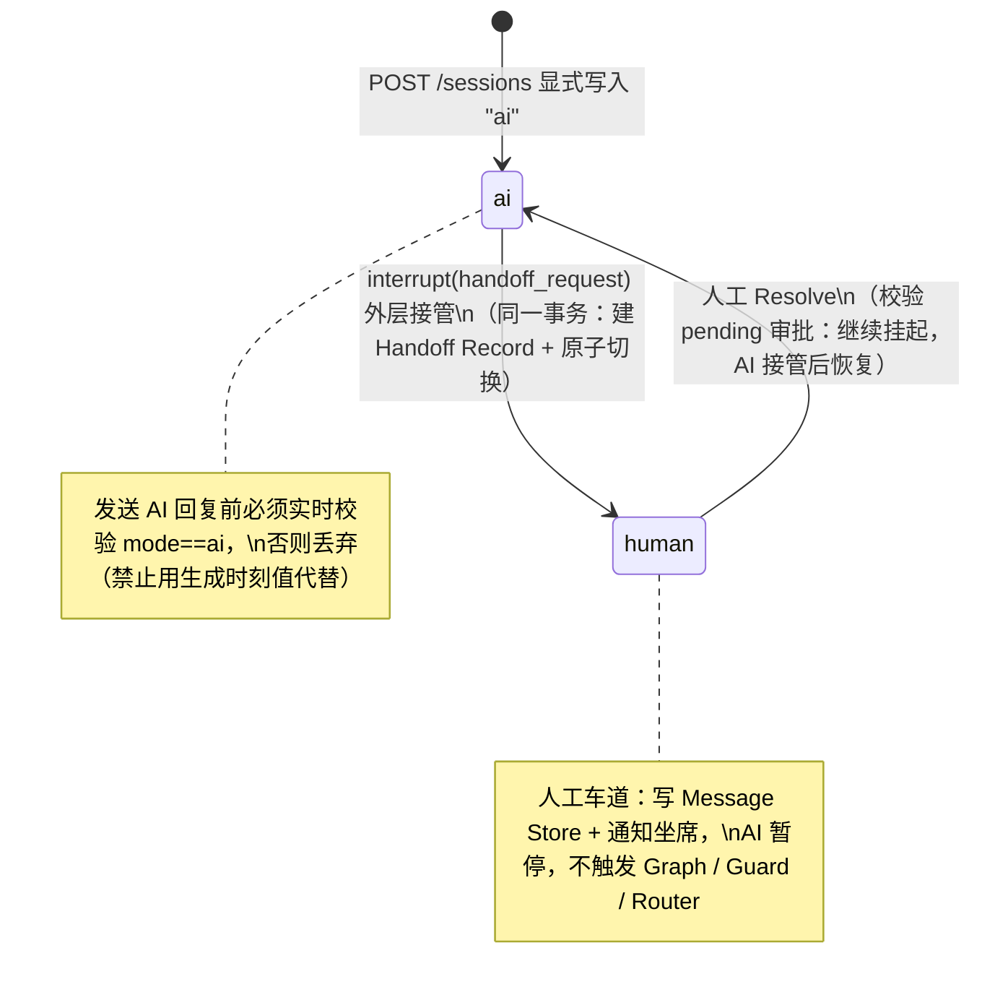

# Handoff 理解确认（2026-09-14）

> 首轮任务第二步验收文档：用自己的话完整复述 5 项内容，作为理解正确性的验收依据。
> 权威定义：`docs/specs/handoff-spec.md`；顶层图：`docs/diagrams/handoff-overview.svg`。

## 1. conversation_mode 完整生命周期

### 状态转换图

### 复述

- **初始化**：新会话 `POST /sessions` 时显式写入 `"ai"`，不依赖存储层隐式默认值；判断为两态（`mode == "human" ? 人工车道 : AI 路径`）。
- **ai → human**：必须与"创建 Handoff Record"处于**同一数据库事务**，原子完成；不允许先建 Record 后切 mode 或反之。触发来源是子图 / `check_handoff` 抛出的 `interrupt(handoff_request)`，由外层执行。
- **human → ai**：由人工 Resolve 触发。切换前**必须校验**该会话是否存在 pending 且与 HighRiskGraph / MutationGraph interrupt 关联的审批；归宿已定案：**继续挂起，等 AI 重新接管后经图内 ResumeHandler / ACTIVE 自然恢复**（见 `docs/decisions/2026-09-14-handoff-decisions.md`）。
- **发送前校验**：任何 AI 回复发送前重新读取实时 `conversation_mode`，仍为 `"ai"` 才发送；已切 `"human"` 则丢弃；不允许用生成时刻的 mode 代替发送前的实时值。

## 2. conversation_mode 判断为什么必须轻量

- 完整 `checkpointer.aget()` 会读取 LangGraph 全部 State（messages、上下文、中断等），对"是否允许 AI 自动回复"这一高频、极简问题过重；且 human 车道本就不该触碰 checkpointer。
- **实现方式**：单独维护轻量 `conversation_status` 存储（独立表或 Redis key），只存 `conversation_id → conversation_mode` 映射；判断在 FastAPI / Conversation Runtime 层、进入任何 LangGraph 逻辑之前完成；`mode == human` 时直接调 Message Service 写消息、通知坐席，不触发 checkpointer / Graph / Guard / Router。
- **长连接**：SSE / WebSocket 可在连接级内存缓存 mode，仅在 `handoff_created` / `handoff_resolved` 事件时主动更新，不要求每条消息重新查库。

## 3. 子图 interrupt(handoff_request) 退出、外层接管

- 三条子图（Read / Mutation / HighRisk）检测到需转人工信号时，**不自行创建 Handoff Record、不自行切换 `conversation_mode`**，统一抛出 `interrupt({"type": "handoff_request", "reason": ..., "summary": ...})`。
- 外层（Conversation Runtime）统一接管：接收信号 → 创建 Handoff Record → 原子切换 `conversation_mode` → 发出 `handoff_created`。子图不直接调用任何 Handoff API。
- 抛出后 `execution_status` 置 `waiting_handoff`；人工 Resolve 回切 `mode=ai` 并发 `handoff_resolved`，下一条消息回到入口判断；图内 ResumeHandler 恢复**原被中断的子图**继续其流程直到完成，不重新走 Router。

## 4. execution_status 新增 waiting_handoff

- 取值（9 个）：`idle` / `routing` / `clarifying` / `running` / `waiting_confirmation` / `waiting_approval` / `waiting_handoff` / `completed` / `failed`。
- `waiting_handoff`：**因中途触发 Handoff 而暂停，既非正常完成也非失败**。子图抛出 `handoff_request` 后**必须**置此值，不得置 `completed` 或 `failed`；人工 Resolve 后由 ResumeHandler 恢复原子图时转回 `running`。

## 5. 三条子图的事件集合

| 子图 | 允许发出的事件 |
|---|---|
| ReadGraph | `tool_call` / `tool_result` / `token` / `error` / `done` |
| MutationGraph | `tool_call` / `tool_result` / `confirmation_required` / `confirmation_updated` / `token` / `error` / `done` |
| HighRiskGraph | `tool_call` / `tool_result` / `approval_required` / `approval_updated` / `token` / `error` / `done` |

- 任意子图触发 Handoff 时额外可能发出 `handoff_created`，**由外层统一发出**，子图自身不直接发出。

## 6. 本轮文档修订记录（按顶层图审计落地）

- 顶层图：`docs/diagrams/handoff-overview.svg`（附件入库，作为会话流程 / 状态机顶层图）。
- **本轮定案（两条，决策留痕见 `docs/decisions/2026-09-14-handoff-decisions.md`）**：① `conversation_id == session_id`，`thread_id` 为 LangGraph checkpoint 标识、一对一映射但独立字段；② human → ai 切换时 pending 审批归宿 = 继续挂起，AI 重新接管后自然恢复。
- 修订：`docs/specs/architecture.md`（§2 入口层 / §4 轻量存储与 Open Decision 标注 / §8.1 handoff 事件）、`docs/specs/graph-spec.md`（§1 退出路径 / §3 ResumeHandler / §6.5 统一机制 / §9 字段表）、`docs/specs/state-spec.md`（新增 `execution_status` 9 值）、`docs/specs/event-spec.md`（`handoff_created` / `handoff_resolved`、§2.1 子图事件集合）、`docs/specs/safety-spec.md`（§2 流程改为 interrupt + 外层接管）、`docs/specs/tool-spec.md`（§4）、`AGENTS.md`（§4 入口层例外 / §14 占位标注 / §18c 执行机制 / §22 两态规则）。
- 新建：`docs/specs/handoff-spec.md`（权威定义）、`docs/diagrams/graph-overview.md`（下层细节图 Mermaid 版，原引用缺失已补齐）。
- **本轮修订决定**：删除 `conversation_mode` 的 invalid 分支，收敛为 `ai` / `human` 两态；读取到缺失 / 意外值时按 `ai` 兜底放行（fail-open），为接受的设计选择。

## 7. 未决问题（禁止擅自决定）

1. LangGraph `state.messages` 与 canonical Message Store 之间谁是唯一真相源。

> 备注：用户曾引用 `docs/decisions/2026-09-xx-handoff-spec-audit.md`，该文件在仓库中不存在；本轮未伪造历史审计文件，首轮审计悬而未决项以上述 §7 为准。
