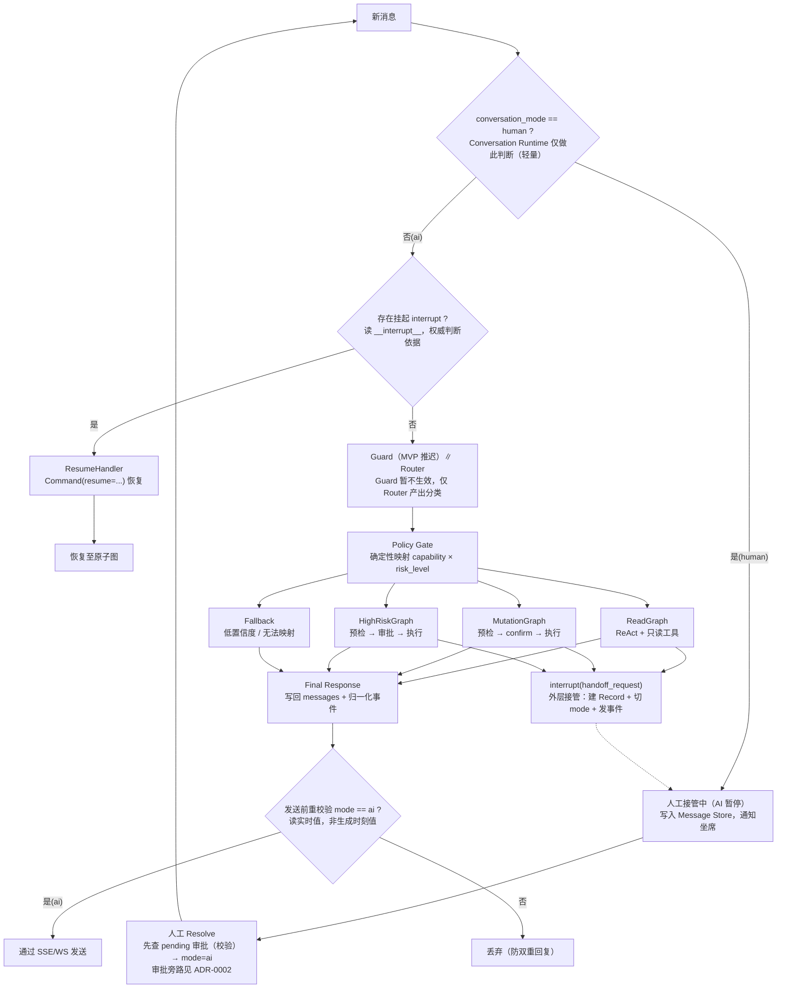

# CustomerServiceGraph 总图（AI 路径内部结构）

> 与 `customer_service_final_architecture.svg` 内容等价（本文件为 Mermaid 源码版）；顶层会话流程见 `handoff-overview.svg`。
> 权威定义：`docs/specs/graph-spec.md`、`docs/specs/handoff-spec.md`。

## 关键注记

- Guard 节点 MVP 阶段推迟生效，不阻断任何请求，但保留占位不删除。
- `conversation_id=session_id`、`thread_id` 独立一对一映射已定案（见 `docs/specs/handoff-spec.md` §5.1）。pending 审批「继续挂起等 AI」归宿 **已废止**（[ADR-0002](../adr/0002-seat-approver-side-channel.md)；`handoff-spec` §1.3 / §5.1 归宿段已 supersede）。`state.messages` 唯一真相源见 Message Store 定案。
- 发送前重校验读取实时 mode 值，非生成时刻值。
