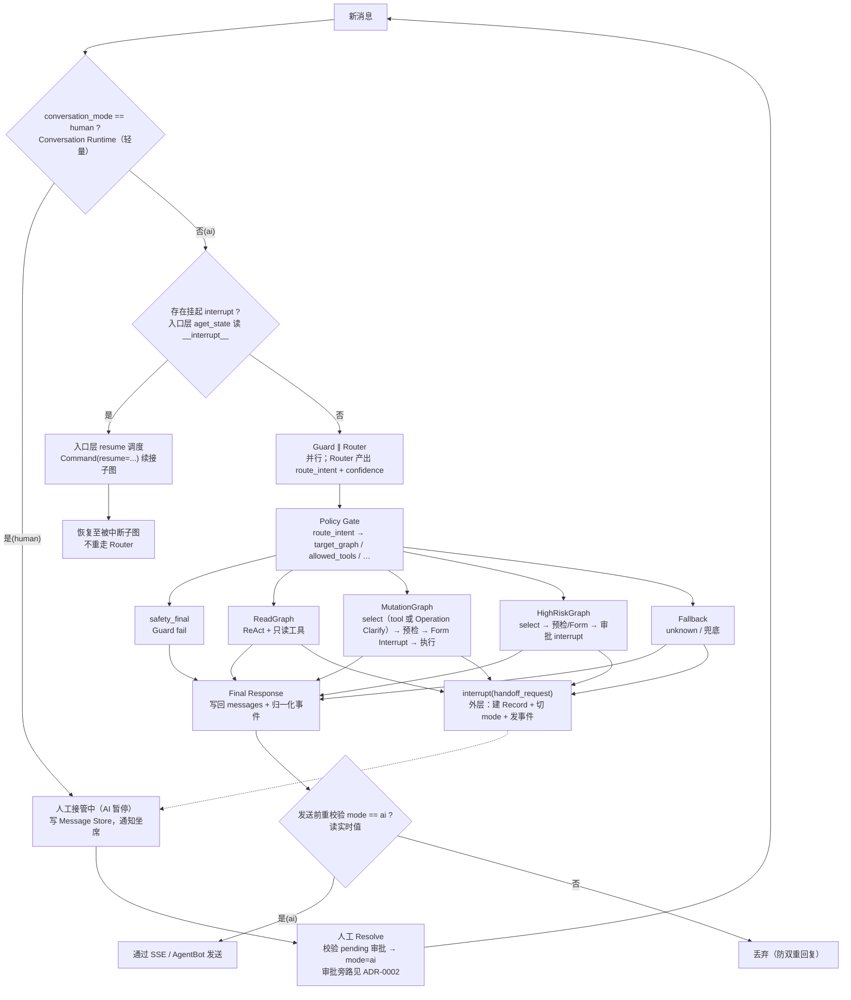

# CustomerServiceGraph 总图（AI 路径内部结构）

> 权威定义：`docs/specs/graph-spec.md`、`docs/specs/handoff-spec.md`。
> 顶层会话流程见 `handoff-overview.svg`。Archify 渲染版见 `架构图/archify-architecture.html`。

## 关键注记

- Guard 为确定性规则包（与 Router 并行）；fail 走 `safety_final`，不消费 Router 分类结果做子图路由。
- Router 唯一语义输出是 `route_intent` + `confidence`；子图选择由 Policy Gate 确定性派生（见 `state-spec.md`）。
- Mutation 主路径用 Form Interrupt（`form_required`），不是聊天 `confirmation_required`；tool 未定由 Mutation `mutation_select_llm` 内联 Operation Clarify（ADR 0004），无入口 Hybrid。HighRisk 工具选择为 `high_risk_select_llm`（ADR 0005）。
- Form / 审批挂起时父图 `execution_status` 常仍为 `routing`；对外权威是 checkpointer `__interrupt__`。
- `conversation_id=session_id`、`thread_id` 一对一映射见 `handoff-spec.md` §5.1。pending 审批「继续挂起等 AI」归宿 **已废止**（[ADR-0002](../adr/0002-seat-approver-side-channel.md)）。
