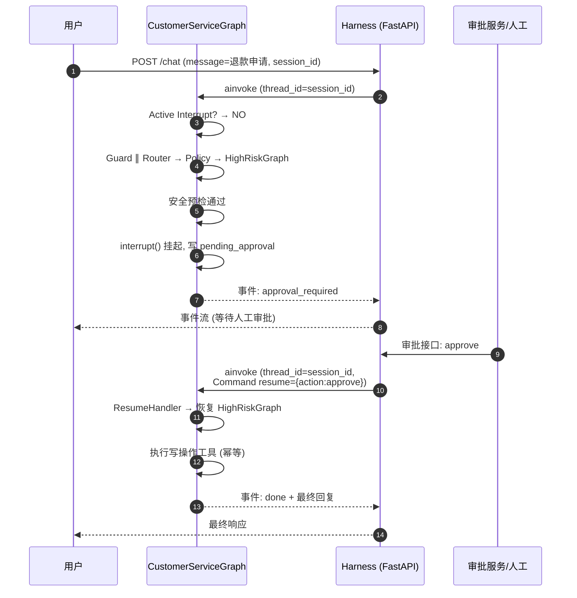
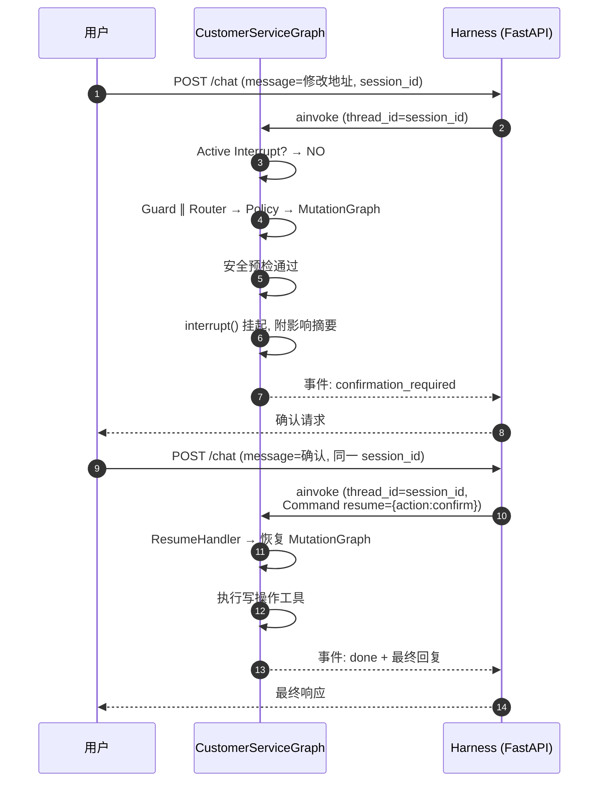
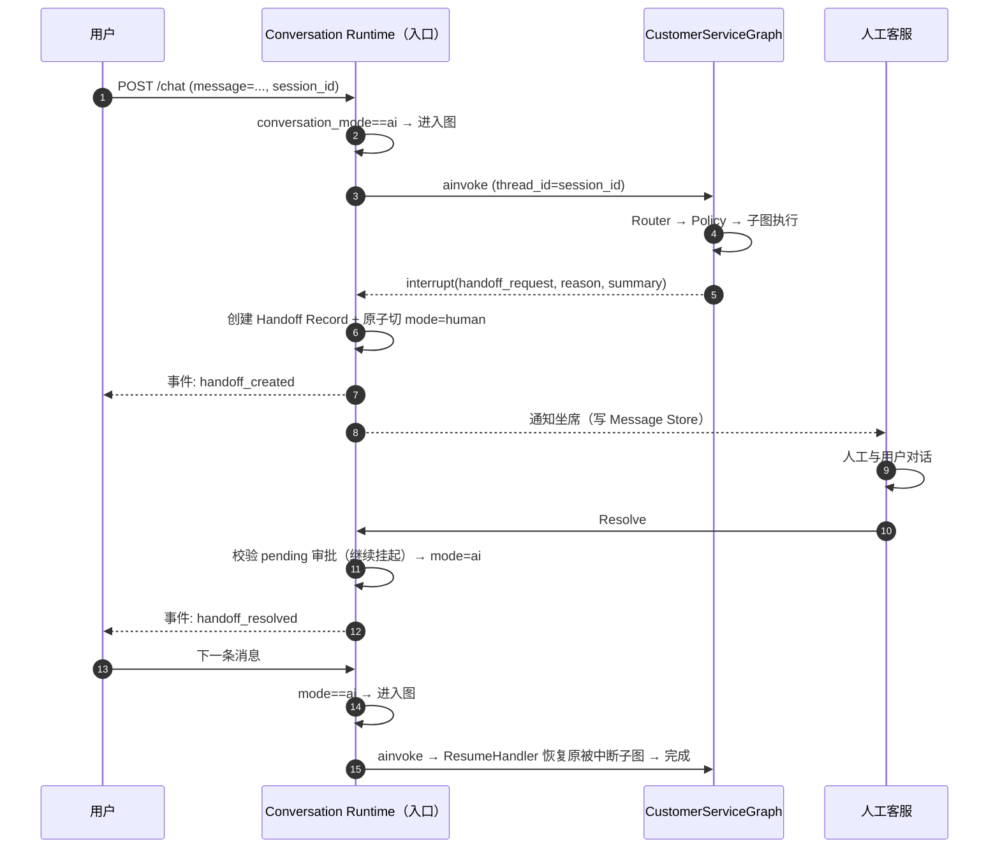

# interrupt / resume 时序图

> 权威定义：`docs/specs/graph-spec.md` §3（ResumeHandler / resume payload schema）、`docs/specs/approval-spec.md`（审批流程）、`docs/specs/event-spec.md`（事件协议）。

## HighRiskGraph：人工审批路径

## MutationGraph：用户确认路径

## 关键规则

- **resume payload 单一 schema**：`Command(resume={ "action": "approve"|"reject"|"confirm"|"cancel", "note"?: str } | { "result": "expired" })`，审批 / 用户确认 / 超时共用（`graph-spec.md` §3）。
- **有挂起中断不得重新 Router**：新消息语义是回应上一个中断，一律先经 ResumeHandler（`graph-spec.md` §1）。
- **恢复后的子图操作必须幂等**：审批可能重复提交或超时后重试（`AGENTS.md` §12）。
- **超时惰性处理**：下一 turn 检查中断过期后以 `Command(resume={"result":"expired"})` 收尾（`graph-spec.md` §3、§6.3）。
- **用户拒绝 / 审批拒绝**：不执行写操作，收尾并记录（`graph-spec.md` §6.2、§6.3）。

## Handoff：子图中途转人工 + 人工 Resolve 回切

## 关键规则（Handoff）

- 子图不自行创建 Handoff Record / 不自行切 `conversation_mode`，统一 `interrupt(handoff_request)`，由外层接管（`handoff-spec.md` §3）。
- 发送 AI 回复前实时校验 `conversation_mode==ai`，否则丢弃（`handoff-spec.md` §1.4）。
- human → ai 切换前必须校验该会话是否存在 pending 审批；归宿定案为继续挂起，AI 重新接管后自然恢复（`handoff-spec.md` §1.3）。
