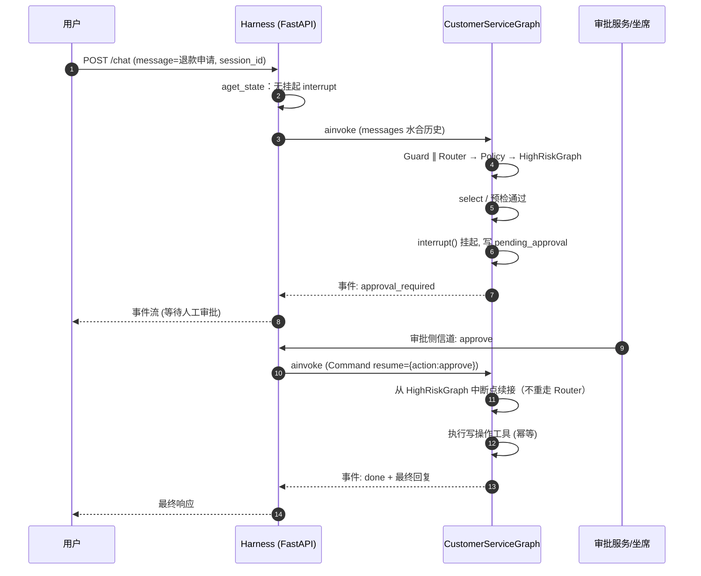
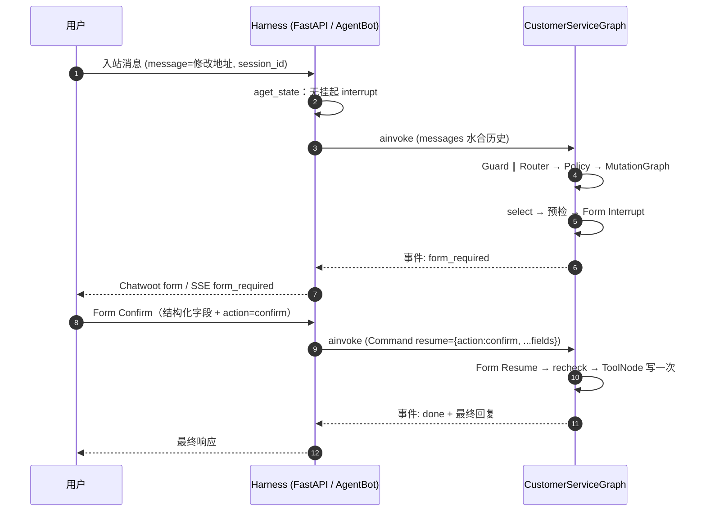
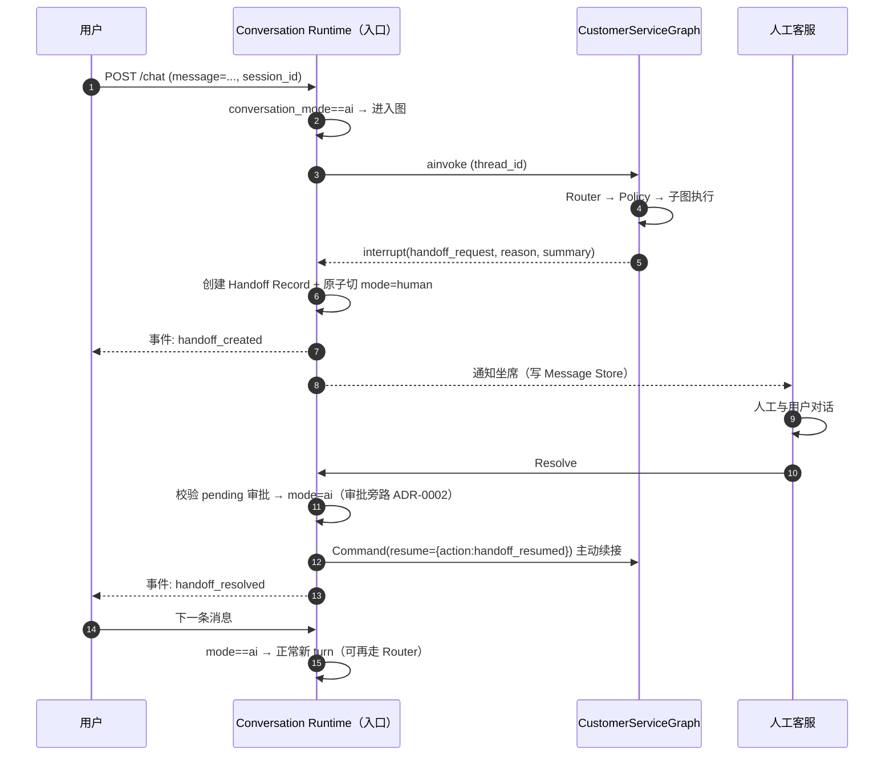

# interrupt / resume 时序图

> 权威定义：`docs/specs/graph-spec.md` §3（入口层 resume 调度 / resume payload schema）、`docs/specs/approval-spec.md`、`docs/specs/event-spec.md`、`docs/specs/mutation-form-interrupt-spec.md`。

## HighRiskGraph：人工审批路径

## MutationGraph：Form Interrupt / Form Resume

## 关键规则

- **resume payload 单一 schema**：`Command(resume={ "action": "approve"|"reject"|"confirm"|"cancel"|"handoff_resumed", "note"?: str } | { "result": "expired" })`（`graph-spec.md` §3）。
- **有挂起中断不得重新 Router**：由入口层 `aget_state` 判定后以 `Command(resume=...)` 发起（无图内 ResumeHandler 节点）。
- **Mutation 主路径事件**：`form_required` / `form_rejected`；不得再发 `confirmation_required`。
- **恢复后的子图操作必须幂等**：审批可能重复提交或超时后重试。
- **超时惰性处理**：下一 turn 以 `Command(resume={"result":"expired"})` 收尾（`graph-spec.md` §3、§6.3）。
- **用户 Cancel / 审批拒绝**：不执行写操作，收尾并记录（`graph-spec.md` §6.2、§6.3）。

## Handoff：子图中途转人工 + 人工 Resolve 回切

## 关键规则（Handoff）

- 子图不自行创建 Handoff Record / 不自行切 `conversation_mode`，统一 `interrupt(handoff_request)`，由外层接管（`handoff-spec.md` §3）。
- 发送 AI 回复前实时校验 `conversation_mode==ai`，否则丢弃（`handoff-spec.md` §1.4）。
- human → ai 切换前必须校验该会话是否存在 pending 审批（校验条仍有效）。旧「归宿=继续挂起、等 AI 接管后自然恢复」**已废止**——Seat Approver / Approval Side-Channel，见 [ADR-0002](../adr/0002-seat-approver-side-channel.md)。
