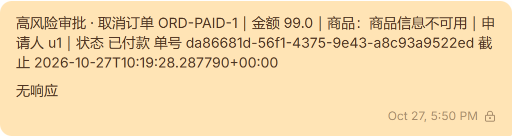
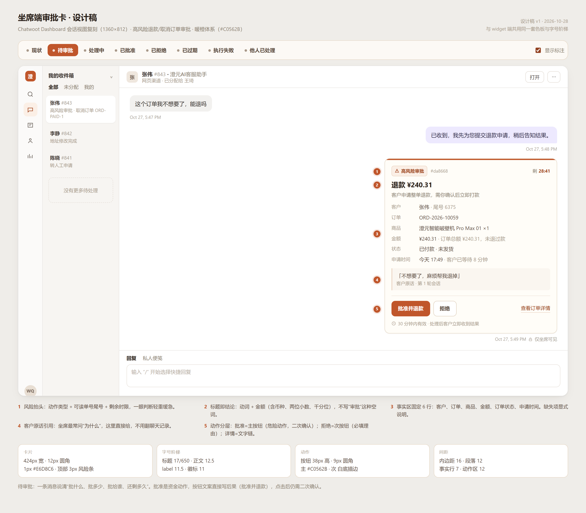

# 坐席端高风险审批：UI 与内容优化方案

> 状态：**方案（未实现）** · 2026-10-28
> 范围：Chatwoot 坐席端（Dashboard）里 `highRiskGraph` 的 `approval_required` 投影
> 配套设计稿：`docs/ops/chatwoot/approval-card-mockup.html`（可切换 8 种状态）

---

## 0. 结论

现在这条消息是**给客户 Widget 写的表单，被投到了坐席端**。Chatwoot 坐席端的表单气泡只渲染 `content` 文本和「已提交值」，**不渲染任何输入控件**——所以坐席看到的是一条无法操作的黄底私备注，连「批准/拒绝」都点不到。

- 数据库里 3 条审批，**0 条被决策**（`decided_by` 全为 NULL），均已过 30 分钟 TTL，客户收到的是「超时未确认，申请已过期」。审批闭环在坐席端是断的。
- 同一个 `approval_id` 被投影了 **3 次**（msg 2023 / 2025 / 2027），会话被刷屏。

建议：把这条消息从「表单」改成**一张只读信息卡 + 两个动作**，分两期落地：

| 期 | 做法 | 工作量 | 得到什么 |
|---|---|---|---|
| 一 | `content` 改为 HTML 卡片 + 签名动作链接 | ~1 天 | 坐席看得懂、点得动（新标签确认页） |
| 二 | 注入 `seat-approval.js/css` 接管按钮 | ~2–3 天 | 真按钮、就地变状态，不离开会话 |

不建议 fork 镜像给 Dashboard 加 `CardsBubble`（维护成本 >> 收益），也不建议用 Dashboard App（整屏切走 + 无徽标，见 §2）。

---

## 1. 现状证据

**坐席端实拍**（conv #843，真实数据，非模拟）：



真实载荷（`GET /api/v1/accounts/3/conversations/843/messages`）：

```json
{
  "id": 2023,
  "content_type": "form",
  "private": true,
  "content": "高风险审批 · 取消订单 ORD-PAID-1｜金额 99.0｜商品：商品信息不可用｜申请人 u1｜状态 已付款\n单号 da86681d-56f1-4375-9e43-a8c93a9522ed\n截止 2026-10-27T10:19:28.287790+00:00",
  "content_attributes": {
    "items": [
      {"name": "approval_id", "type": "text", "default": "da86681d-…"},
      {"name": "decision", "label": "审批决定", "type": "select",
       "options": [{"label": "批准", "value": "approve"}, {"label": "拒绝", "value": "reject"}]},
      {"name": "note", "label": "拒绝备注（可选）", "type": "text"}
    ]
  }
}
```

`items` 里的批准/拒绝下拉、备注框，坐席端**一个都没渲染**。

### 问题清单

| # | 问题 | 证据 | 影响 | 级别 |
|---|---|---|---|---|
| 1 | 无法决策 | `bubbles/Form.vue` 只渲染 `content` + `submittedValues` | 审批只能走 API，坐席无路可走 | P0 |
| 2 | 重复刷屏 | 同一 `approval_id` 3 条，间隔 9s / 24s | 会话被占满，坐席以为有 3 单 | P0 |
| 3 | 决策事实缺失 | 金额无币种、`商品信息不可用`、`申请人 u1` | 坐席无法判断该不该批 | P0 |
| 4 | 时间不可读 | `截止 2026-10-27T10:19:28.287790+00:00`（UTC 微秒串） | 不知道还剩多久 | P1 |
| 5 | 零视觉层级 | 14px/20px 三行同字号、黄底 `#FFE4B5`、512×136 | 与「闲聊提醒」同权重，容易漏看 | P1 |
| 6 | 「无响应」误导 | FormBubble 在 widget inbox 且无提交值时追加 `NO_RESPONSE` | 被读成"客户没回复"，实际是"表单没提交" | P1 |
| 7 | 无状态回执 | 决策后消息文本不变 | 无法确认是否处理过，重复点击 | P1 |
| 8 | 拒绝无理由 | `note` 字段存在但坐席端不可用 | 客户只收到"未通过审核"，坐席要另发消息解释 | P2 |
| 9 | 卡片内容类型也无效 | Dashboard 无 `CardsBubble`，`cards` 落到 `TextBubble` | 「发张卡片」这条路在坐席端是死的 | 事实 |

---

## 2. 坐席端能力边界（决定方案的硬约束）

| 载体 | 坐席端渲染 | 可点动作 | 内联提交 | 备注 |
|---|---|---|---|---|
| `text` 私备注 | ✅ markdown（bold/列表/链接） | 仅链接 | ❌ | 最稳，但只能是文本 |
| `form` / `input_select` | ⚠️ 只渲染 `content`（**HTML 会被 `v-dompurify-html` 渲染**）+ 已提交值 | ❌ | ❌ | 当前方案用的就是它 |
| `cards` | ❌ 退化为 `TextBubble`，只剩 `content` | ❌ | ❌ | 仅 Widget 有 `CardMessage` |
| Dashboard App（iframe tab） | ✅ 自定义页面 | ✅ | ✅ | 整屏切走、`show-badge: false`，无未读提醒 |
| 注入式增强（layout 覆盖 + 自有 JS/CSS） | ✅ | ✅ | ✅ | 依赖 DOM 结构，升级需回归 |

两个关键事实：

1. **`form` 的 `content` 走 `v-dompurify-html`**，允许 `<div>/<span>/<a>/<style 属性>`（`script`、`onclick` 会被剥掉）。这意味着**不用改镜像就能画出真卡片**。
2. 我们已经在用「覆盖 layout + 挂载自有 CSS」这套办法（Z2 的 `widgets-show.html.erb`、`widget-commercial.css`）。坐席端对应 `app/views/layouts/vueapp.html.erb`，**同样可以覆盖**，且 `config/initializers/content_security_policy.rb` 里的 CSP 是注释状态，外链 JS/CSS 不会被拦。

---

## 3. 行业参考（提炼成原则）

| 产品 | 形态 | 可借鉴 |
|---|---|---|
| Stripe 复核队列 | 列表 + 详情抽屉，金额/风险信号/证据齐备 | 决策所需事实 100% 在卡内，不跳转 |
| Shopify Flow 审批 | 卡片 + 批准/拒绝 + 拒绝理由 | 拒绝必填理由，理由回流 |
| Zendesk 审批工单 | 工单状态机 + 审计 | 终态固化，谁/何时/结果 |
| Slack Block Kit / Teams Adaptive Card | 消息内按钮，点击后卡片**原地**变结果 | 就地状态迁移，不刷屏 |
| Intercom | 侧栏上下文面板 | 不打断消息流（我们用私备注近似） |

归纳 6 条（本方案的判据）：

1. 一个审批 = 一个决策单元，事实齐备，不需要切页面。
2. 标题写**后果**（"退款 ¥240.31"），不写"审批"这种空词。
3. 动作分层：一个主操作、一个次操作、一个详情链接。
4. 危险动作二次确认，并说明**结果可预期**（打多少钱、多久到账）。
5. 拒绝必填理由，理由原样回到客户。
6. 状态固化 + 审计；并发、过期、失败都有明确出口。

---

## 4. 卡片设计



### 4.1 信息架构（5 区）

1. **风险抬头**：`高风险审批` 徽标 + `#da8668`（单号后 6 位）+ `剩 28:41`
2. **标题即结论**：`退款 ¥240.31` + 一行副标题说明"批准会发生什么"
3. **事实区（固定 6 行）**：客户 / 订单 / 商品 / 金额 / 订单状态 / 申请时间
4. **客户原话引用**：坐席最常问的"为什么"，直接给
5. **动作区**：`批准并退款`（主）+ `拒绝`（次）+ `查看订单详情`（链）+ 一行脚注（有效期 / 客户可见性）

### 4.2 文案表（现状 → 建议）

| 字段 | 现状 | 建议 | 规则 |
|---|---|---|---|
| 抬头 | `高风险审批 · 取消订单 ORD-PAID-1` | `高风险审批 · #da8668 · 剩 28:41` | 单号只留后 6 位；完整单号进详情 |
| 标题 | （无） | `退款 ¥240.31` / `取消订单 ORD-2026-10059` | 动词 + 金额/单号，一行读完 |
| 副标题 | （无） | `客户申请整单退款，需你确认后立即打款` | 说清批准的后果 |
| 客户 | `申请人 u1` | `张伟 · 尾号 6375` | 不暴露内部 `user_id` |
| 订单 | `ORD-PAID-1` | `ORD-2026-10059` | 完整可读单号 |
| 商品 | `商品：商品信息不可用` | `澄元智能破壁机 Pro Max 01 ×1` | 缺数据写「商品信息暂缺，查看订单详情」，别写"不可用" |
| 金额 | `金额 99.0` | `¥240.31 · 订单总额 ¥240.31，未退过款` | 币种 + 两位小数 + 千分位；退款补「已退金额」 |
| 订单状态 | `状态 已付款` | `已付款 · 未发货` | 带「是否可退」的判定依据 |
| 时间 | `截止 2026-10-27T10:19:28.287790+00:00` | `今天 17:49 · 客户已等待 8 分钟` / `剩 28:41` | 本地时区；ISO 串只进日志 |
| 客户原话 | （无） | `「不想要了，麻烦帮我退掉」` | 引用块，注明第几轮 |
| 主按钮 | `批准`（下拉项） | `批准并退款` | 动词 + 后果；点击后二次确认 |
| 次按钮 | `拒绝`（下拉项） | `拒绝` | 打开理由弹层，理由必填 |
| 详情 | （无） | `查看订单详情` | 新标签打开 |
| 脚注 | （无） | `30 分钟内有效 · 处理后客户立即收到结果` | SLA + 客户可见性 |
| 终态 | （无） | `已批准 · 王琦 · 17:52` / `已拒绝 · 理由：商品已发货` | 谁 / 何时 / 结果 |
| 隐藏 | `无响应` | 不显示 | 注入 CSS 隐藏，见 §6 第 8 条 |

**语气**：对坐席用「你」（内部工具，短句、命令式）；不写「请」「麻烦」。数字优先于形容词。

### 4.3 状态矩阵

| 状态 | 触发 | 卡片表现 | 可点动作 | 客户侧 |
|---|---|---|---|---|
| 待审批 | `approval_required` | 风险条橙、倒计时、完整事实 + 原话 | 批准 / 拒绝 / 详情 | 等待中（已有"稍后告知"） |
| 处理中 | 已提交决策，resume 中 | 按钮转圈置灰，`已由 王琦 批准，正在执行…` | — | 等待 |
| 已批准 | `approved` | 风险条转绿，保留客户/订单/金额（弱化），结果句 | 详情 / 处理记录 | `退款 1–3 个工作日到账` |
| 已拒绝 | `rejected` | 风险条转红，显示理由 | 详情 | 收到理由 + 后续建议 |
| 已过期 | TTL 到（默认 30 分钟） | 灰、`超时 30 分钟`、说明客户已收到什么 | 详情 | `申请已过期，可重新发起` |
| 执行失败 | 审批通过但工具报错 | 红、处理编号 `8f3a1c2b` | 重试 / 转人工 / 日志 | 已收到「稍后重试或转人工」 |
| 他人已处理 | 并发（后端 409） | 灰、`李娜 已于 17:51 批准`，按钮不可点 | 处理记录 | — |

### 4.4 视觉规范

沿用 widget 端的暖橙体系，坐席端更克制（工作台，信息密度优先）。

| Token | 值 | 用途 |
|---|---|---|
| `--accent` | `#C0562B` | 风险条、主按钮、徽标文字 |
| `--accent-strong` | `#A2461F` | 主按钮 hover、链接 |
| `--accent-soft` | `#FBEFE6` | 徽标底 |
| `--surface` | `#FFFDF8` | 卡片面 |
| `--line` | `#E6D8C6` | 卡片边框 |
| `--ink` / `--ink-2` / `--ink-3` / `--ink-4` | `#2A211B` / `#5A4A3D` / `#8A7C6D` / `#A9998A` | 标题 / 正文 / 次要 / 极弱 |
| `--ok` / `--danger` | `#2F7A57` / `#B23A2E` | 终态语义色（不参与品牌） |

尺寸：卡片 424px 宽、12px 圆角、16px 内边距、顶部 3px 风险条；标题 17/650；事实 12.5；label 11.5；按钮 38px 高 / 9px 圆角；段落间距 12，事实行距 7。金额与时间统一 `font-variant-numeric: tabular-nums`。

**为什么不是绿色**：坐席端的主色必须与客户看到的 widget 一致（暖橙 `#C0562B`），否则同一单在两屏之间割裂；绿色只作为「已批准」的语义色出现。

**暗色模式**：Chatwoot 支持暗色。建议 `@media (prefers-color-scheme: dark)` 下卡片面 `#221C17`、边框 `#3A2F26`、正文 `#F1E7DC`、弱化 `#A9998A`，风险条与按钮保持 `#C0562B`（对比度 4.9:1）。

### 4.5 交互

**批准（危险动作，二次确认）**

```
点击「批准并退款」
  → 确认层：「将退款 ¥240.31 至原支付渠道，预计 1–3 个工作日到账。批准后不可撤回。」
  → 确认 → 卡片进入「处理中」→ 结果态
```

为什么必须二次确认：金额误读的成本是钱；且批准是**不可逆**动作。确认层文案只重复两个事实（金额、到账时效），不重复整张卡。

**拒绝（必填理由）**

```
点击「拒绝」
  → 弹层：常用原因（金额有误 / 商品已发货 / 疑似欺诈 / 超出权限 / 其他）+ 备注
  → 提交 → 卡片「已拒绝 · 理由：…」
```

理由会原样进客户话术，所以不做成可选的"备注"。

**并发 / 过期 / 失败**：见 §4.3；共同点是**按钮一定进入明确终态**，不留"点了没反应"。

### 4.6 渲染约束（实现时必须遵守）

- `content` 是 HTML，但**会话列表、通知栏、搜索**会走 `getPlainText()` 把标签拉平。所以 DOM 的文本顺序必须能线性阅读（抬头 → 标题 → 事实 → 原话 → 动作），装饰性元素里不要放文案。
- DOMPurify 白名单：`style` / `class` / `<a href>` 可用；`<script>`、`onclick` 等被剥掉。卡片只能是纯静态样式。
- 必须 `private=true`；`content_attributes.items` 保留但坐席端不渲染，**不要依赖它承载任何决策信息**。

---

## 5. 两期落地

### 阶段一：卡片化私备注（~1 天，改 Python）

`content_type` 仍是 `form`（为了 HTML 渲染路径），`content` 换成 `render_approval_card()` 产出的 HTML；`items` 保留（不影响渲染，留作兼容）。按钮是 `<a href>`，指向 runtime 的签名确认页。

优点：零前端工程、可立即上线、与现有 `send_interactive_message` 兼容。
代价：点按钮会开新标签；消息文本不会就地变状态（决策后由 runtime 补发一条"已处理"私备注，形成时间线）。

### 阶段二：真按钮（~2–3 天，注入式增强）

覆盖 `app/views/layouts/vueapp.html.erb`（照 Z2 的做法），追加：

```erb
<link rel="stylesheet" href="/chengyuan/seat-approval.css">
<script src="/chengyuan/seat-approval.js" defer></script>
```

- `seat-approval.css`：隐藏 `无响应`、微调私备注底色、暗色模式补丁
- `seat-approval.js`：`MutationObserver` 找到卡片里的 `a[data-approval-action]` → 换成按钮 → 点击走 `fetch` → 就地替换为结果态；失败回退成链接（渐进增强）

身份与鉴权：卡片 HTML 上带 `data-decision-token`（HMAC，绑定 `approval_id` + `conversation_id` + 15 分钟 TTL + 一次性 nonce），JS 不需要拿到 `seat_secret`；审计里的 `decided_by` 取 Chatwoot 当前坐席（`/api/v1/profile`）。

### 不推荐

- **Dashboard App tab**：会整屏切走会话，且 `show-badge: false`（有新审批时没有红点），坐席根本不会主动切过去。
- **fork 镜像加 `CardsBubble`**：体验最好，但每次 Chatwoot 升级都要重打镜像 + 回归 Vue 组件，长期成本高于收益。

---

## 6. 改动清单（文件级）

| # | 文件 | 改动 |
|---|---|---|
| 1 | `graph/workflows/copy.py` | `approval_summary()` 之外新增 `approval_facts()` → 返回结构化 dict（tool / order_id / amount / currency / order_total / refunded / product_summary / order_status / customer_name / phone_tail / requester_user_id / requested_at / expires_at / customer_quote）；`approval_summary()` 保留，仅用于日志与审计 |
| 2 | `graph/workflows/high_risk_agent.py::approval_pause` | interrupt value 增加 `facts`（dict），供投影层渲染 |
| 3 | `harness/approvals.py` | `approval_record` 加 `payload_json TEXT` + `projected_at TEXT`；`insert_if_absent` 落库；`_row_to_dict` 返回；新增 `mark_projected()` |
| 4 | `harness/approval_side_channel.py` | `make_approval_interrupt_callback` 事件带 `facts`；`send_approval_form` → `send_approval_card`；`project()` 按 `approval_id` 幂等（`projected_at` 为空才发），修掉 3 连发 |
| 5 | `harness/approval_card.py`（新） | HTML 渲染（全部字段 `html.escape`）+ `sign_decision_token()` / `verify_decision_token()` |
| 6 | `harness/server.py` | `GET /approvals/{id}/decide`（确认页，HTML，暖橙体系）→ `POST` 走 `ApprovalSideChannel.decide`；决策后补发一条"已处理"私备注 |
| 7 | `graph/workflows/copy.py::approval_approved_text` | 补「预计 1–3 个工作日到账」，与卡片文案一致 |
| 8 | `docs/ops/chatwoot/seat-approval.{css,js}`（新，阶段二） | 隐藏「无响应」、按钮接管、就地状态；`vueapp.html.erb` 覆盖 + compose 只读挂载 |

**幂等说明**：重复投影的根因是同一 `approval_id` 在多轮事件里被反复 `project()`（实测 3 条）。`insert_if_absent` 已经保证存储幂等，投影层没有——加 `projected_at` 即可，不依赖消息历史去重（沿用 `HandoffService.created` 的同一原则）。

**安全**：卡片必须 `private=true`（客户不可见）；动作链接必须带签名与 TTL，且一次性；现有 `decide_from_seat_form` 用共享 `seat_secret` 当"工牌"，等于任意坐席都能批，建议一并收紧（阶段二用 token + 坐席身份）。

---

## 7. 验收标准

1. 同一 `approval_id` 只出现 1 条（连点/重入不刷屏）
2. 380–460px 宽度内不溢出，金额与倒计时不换行
3. 坐席 3 秒内能回答：批什么、多少钱、给谁、还剩多久
4. 点「批准」有二次确认；确认后 2 秒内卡片变结果态
5. 拒绝必须填理由，理由出现在卡片与客户话术中
6. 并发：第二个坐席看到「已由他人处理」，按钮不可点
7. 过期：卡片与客户侧都有明确交代
8. 暗色模式下对比度 ≥ 4.5:1

---

## 8. 风险与不做的事

- HTML 受 DOMPurify 白名单限制：`style` / `class` / `<a>` 可用，`script` / 事件属性被剥——卡片必须是纯静态样式，不能塞交互脚本（交互放阶段二）。
- 阶段二依赖 Chatwoot DOM 结构，升级需回归（已在 `chatwoot-widget-form.md` 里记录同类风险）。
- 不把审批卡发给客户（必须 `private`）；不改 Chatwoot 镜像；不动现有 `ApprovalService` 的决策语义（审批仍在图内）。
- 「商品信息不可用」的根因是 `precheck_data.product_summary` 缺失，属数据侧问题，卡片只能兜底展示，需另开单补。

---

## 附录：LangGraph 官方 HITL 组件调研（2026-10-28）

| 层 | 官方组件 | 状态 | 能不能解决我们的问题 |
|---|---|---|---|
| 原语 | `langgraph.types.interrupt()` / `Command(resume=...)` | **已在用**（`high_risk_agent.approval_pause`） | 是。暂停/恢复本来就是它 |
| 中间件 | `langchain.agents.middleware.HumanInTheLoopMiddleware`（langchain 1.4.0 已装） | 未用 | 只适用 `create_agent` 的 tool-call 审批；我们是显式 StateGraph，不适用 |
| UI | `langchain-ai/agent-inbox`（Next.js 独立应用） | 未用 | 不可嵌入 Chatwoot；无 npm 组件包 |
| UI | LangGraph Studio（`langgraph dev`） | 未用 | 开发期看中断/恢复，不是坐席端 |

### 可以借的三样东西（建议采纳）

1. **payload 形状**：Agent Inbox 消费的是
   `HumanInterrupt{action_request{action,args}, config{allow_accept,allow_ignore,allow_respond,allow_edit}, description}`
   —— 正好等于一张审批卡需要的数据：动作、参数、允许的决策、可读描述。把我们的 interrupt value 套进这个形状（再挂业务扩展字段），以后要接 Agent Inbox / Studio 零改造。
2. **决策语义**：`approve / edit / reject(message) / respond`。我们的"拒绝必填理由"就是 `reject.message`；**`edit` 是我们现在没有的能力**（坐席改退款金额后再批），值得进二期。
3. **`when` 谓词**：`InterruptOnConfig.when` 按条件决定要不要拦（如"金额 > 500 才审批"），比写死工具白名单灵活。

### 为什么不能直接把 Agent Inbox 当坐席端

- 它是独立 Next.js 应用，没有可嵌入的组件包（npm 上无官方 `@langchain/agent-inbox`）。
- 需要 **LangGraph Server / Platform** 的 deployment URL + LangSmith API key；我们跑的是自定义 FastAPI harness（`langgraph.json` 虽然暴露了 `harness/graph.py:app`，但线上不走 Server API）。
- 它的信息模型是「线程队列」，Chatwoot 是「会话 + 坐席分配 + 客户上下文」，两套 ID、权限、审计对不上。
- 我们的 `approval_record` 已经承担 TTL / 幂等 / `decided_by` 审计 / 座位语义，Agent Inbox 不接管这些。

### 可选：把它当演示面板

`langgraph dev` 起本地 Server + 自建 Agent Inbox，能在 1 小时内得到一个"审批收件箱"页面，适合内部演示或调试（看 interrupt 载荷、点 accept/edit/reject）。但它替代不了 Chatwoot 里的坐席体验，只能作为旁路。
